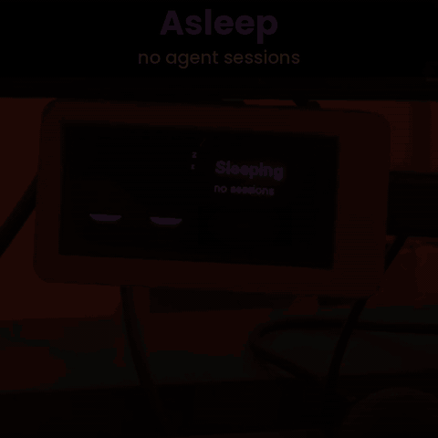

# Agent Needs You

A desk status light for AI coding agents: [Claude Code](https://claude.com/claude-code), Cursor and Codex. A LilyGO T-Display S3 AMOLED shows whether any session is working, finished, or blocked waiting on you, so a permission prompt never sits unnoticed in a background window.

<p align="center"></p>

The screen is a pair of eyes with the details beside them. The eyes show how each session is doing:

| Face | Meaning |
|---|---|
| Blue, **focused**: narrowed eyes reading back and forth, the odd bead of sweat | **Working**: the agent is busy |
| Amber, **curious**: big eyes looking around, head tilting, a bobbing "?" | **Needs you**: permission prompt or idle input wait; the message is shown |
| Green, **happy**: ^ ^ eyes bouncing, blushing, sparkles | **Your turn**: the agent finished its reply (calm and grey-green once seen) |
| Lilac, **drowsy**: half-lidded, slow blinks | An idle session |
| Lilac, **asleep**: eyes shut, Zzz, the odd peek | No sessions; shows the board's IP |

Beside the eyes: the state, the project, how long it has been in that state, the message when it needs you, and a count of sessions per state.

Cursor and Codex sessions are labelled with the agent name, e.g. `aice (cursor)`.

The screen rotates through the sessions, most urgent first (needs you > working > your turn), and keeps the urgent ones up longer: 15 seconds for *needs you*, 8 for *working*, 4 for *your turn* (2 once seen). Idle sessions are only shown when nothing else is going on. When a session finishes or starts waiting on you, it is shown straight away (8 seconds for *your turn*) before the rotation carries on. Working sessions go stale after 30 minutes; finished ones clear after 2 hours.

**Buttons:** BOOT marks every *your turn* session as seen (grey); one left unseen turns grey by itself after 15 minutes. The other button cycles which session is shown and holds it for 30 seconds before the rotation resumes.

## Hardware

LilyGO T-Display S3 AMOLED (ESP32-S3R8, 16 MB flash, 8 MB PSRAM, RM67162 240x536 over QSPI). Powered over USB.

## Build and flash

Needs [PlatformIO](https://platformio.org/).

```bash
cp include/secrets.h.example include/secrets.h   # then fill in Wi-Fi details
pio run -t upload
```

`include/secrets.h` is gitignored. Set `STATIC_IP` there (or reserve the address in your router) so the hooks always find the board. The upload port in `platformio.ini` is `COM4`; change it for your machine.

After boot the board prints `wifi up: http://<ip>/` over serial and shows the IP on its idle screen.

## Agent hooks

Install hooks for every agent found on the machine. Works on Windows, macOS and Linux; needs Python 3.8+, standard library only. No clone needed:

```bash
# macOS / Linux
curl -fsSL https://raw.githubusercontent.com/AncientiCe/agent-needs-you/main/hooks/install.py | python3 - --ip <device-ip>
```

```powershell
# Windows (PowerShell)
irm https://raw.githubusercontent.com/AncientiCe/agent-needs-you/main/hooks/install.py | python - --ip <device-ip>
```

From a clone, run `python hooks/install.py --ip <device-ip>` instead (`python3` on macOS/Linux). Options go after the `-` in the one-liners too, e.g. `... | python3 - --uninstall`.

Hooks call the Python that ran the installer (or the system Python, if run from a virtualenv), so install with the interpreter you want the hooks to use.

Options: `--agents claude,cursor,codex` to pick agents, `--dry-run` to see what would change, `--uninstall` to remove the hooks. Run it on each computer whose agents should report to the board.

The installer copies [`hooks/relay.py`](hooks/relay.py) to `~/.claude-light/` and adds one hook per event to `~/.claude/settings.json`, `~/.cursor/hooks.json` and `~/.codex/hooks.json`. Existing hooks are kept, earlier Agent Needs You hooks are replaced, and each changed file is backed up next to itself (`*.bak-claude-light-<timestamp>`).

The relay converts each agent's hook payload to the board's format, posts it with a one-second timeout, prints whatever the agent expects from a hook, and always exits 0. If the board is off, hooks carry on normally.

| Board state | Claude Code | Codex | Cursor |
|---|---|---|---|
| Working | `UserPromptSubmit`, `PostToolUse` | `UserPromptSubmit`, `PostToolUse` | `beforeSubmitPrompt`, `postToolUse` |
| Needs you | `Notification` | `PermissionRequest` | — |
| Your turn | `Stop` | `Stop`, `Interrupt` | `stop` |
| Added / removed | `SessionStart` / `SessionEnd` | `SessionStart` / `SessionEnd` | `sessionStart` / `sessionEnd` |

Notes:
- **Codex** skips new hooks until you trust them: run `/hooks` in Codex once after installing.
- **Cursor** has no hook that fires when it waits for your approval without also answering it, so Cursor sessions show working and your turn, never needs you.
- Already-running sessions may need a restart to pick up new hooks.

### Anything else

Any script can drive the board directly:

```bash
curl -s -m 2 -H "Content-Type: application/json" \
  -d '{"hook_event_name":"Notification","session_id":"ci-build","cwd":"my-project","message":"CI failed","agent":"ci"}' \
  http://<device-ip>/hook
```

`hook_event_name` is one of `UserPromptSubmit` (working), `Notification` (needs you), `Stop` (your turn) or `SessionEnd` (remove). The last folder of `cwd` is the label; `agent` and `message` are optional. The board tracks up to 8 sessions.

## Debugging

- `GET /` returns the session table as JSON.
- The same hook JSON can be sent as one line over USB serial (115200 baud). Other serial commands: `state` prints the table, `test` shows colour bars for 20 seconds, `inv0`/`inv1` toggle colour inversion.
- Opening the serial port with DTR/RTS asserted resets the board and clears the session list.

The firmware streams each request body through an ArduinoJson filter rather than buffering it, so large `PostToolUse` payloads (hundreds of KB of tool output) don't exhaust RAM.

## License

MIT. See [LICENSE](LICENSE).
